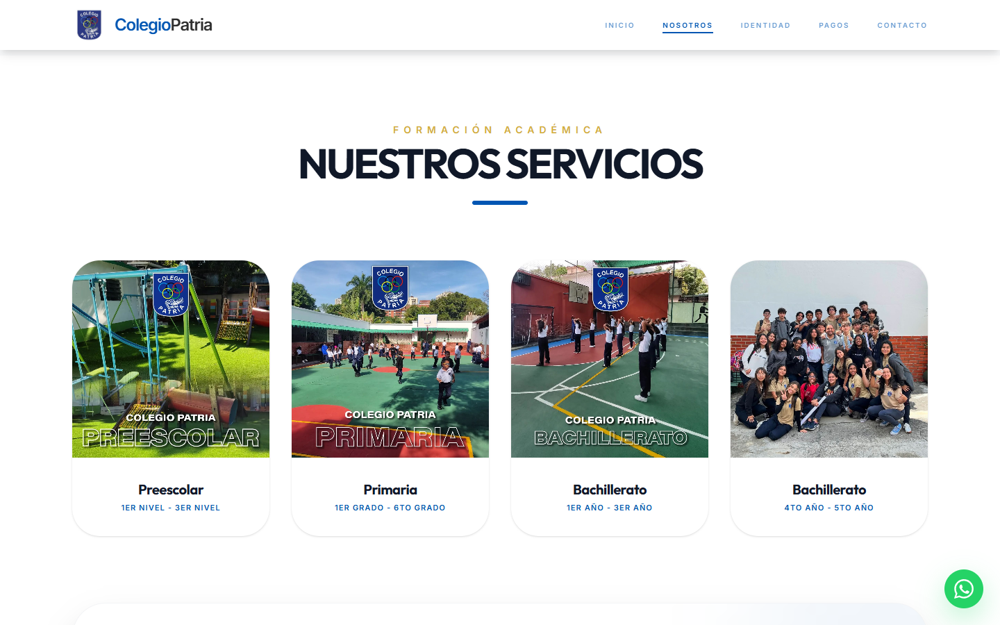
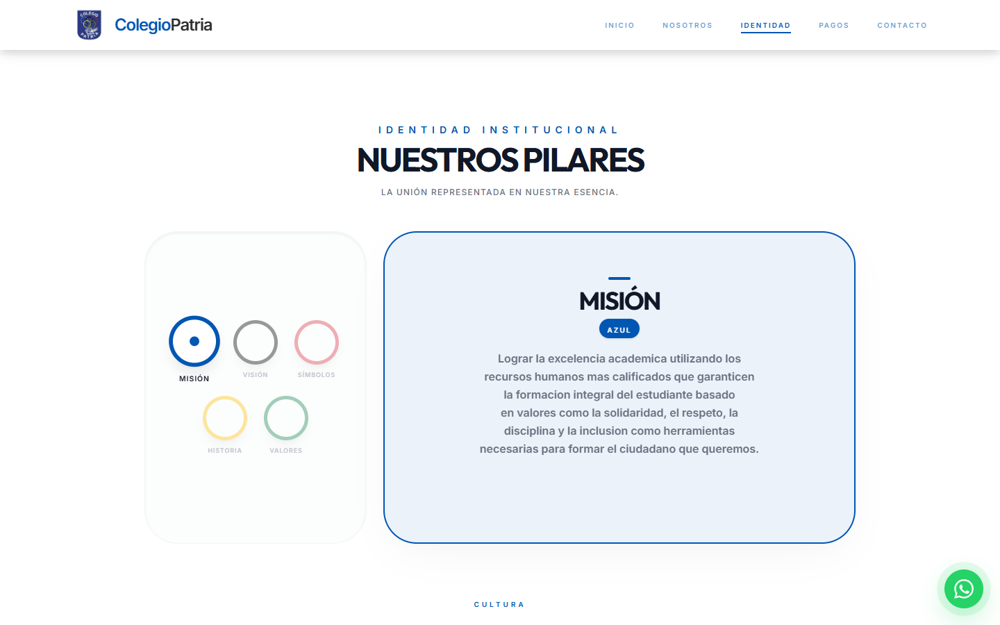
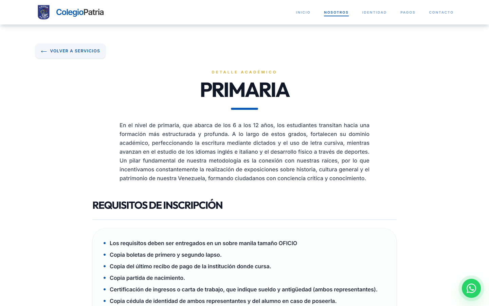
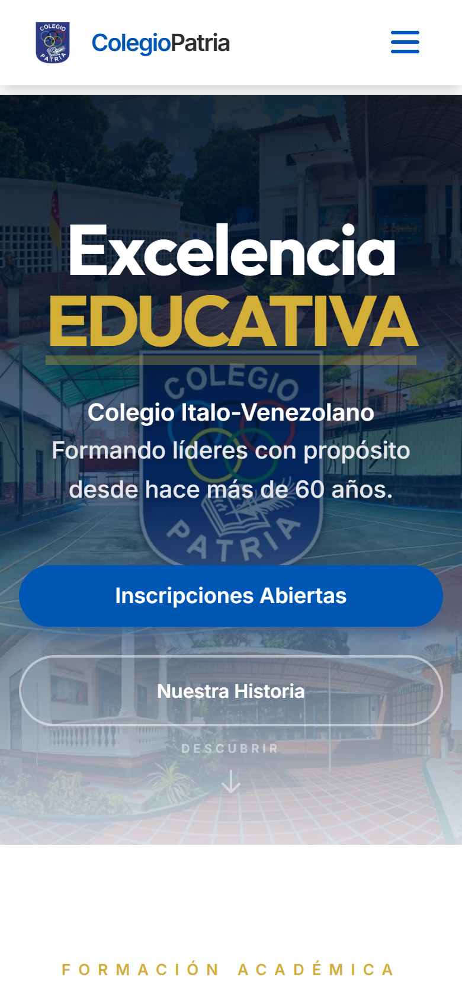

<div align="center">


# Colegio Patria — Sitio institucional

**Plataforma web oficial de la U.E. Colegio Patria**, institución ítalo-venezolana con más de 60 años de trayectoria en Los Chorros, Caracas.

[](https://www.colegiopatria.com/)

&nbsp;
&nbsp;
&nbsp;
&nbsp;
&nbsp;


`En producción` · `Cliente real` · `Responsive`

</div>

---

<div align="center">
  
</div>

## El proyecto

El colegio necesitaba dejar atrás una presencia digital dispersa y tener un sitio propio que sirviera a la vez como **carta de presentación para nuevas familias** y como **canal de atención para los representantes actuales**: requisitos de inscripción, listas de útiles, datos de pago y contacto directo, todo en un solo lugar y desde el teléfono.

Diseñé y desarrollé el sitio de punta a punta: levantamiento de información con la institución, diseño de la interfaz, desarrollo, SEO y despliegue en dominio propio.

---

## Funcionalidades

**🎓 Oferta académica por nivel**
Rutas dinámicas (`/academia/:nivel`) para Preescolar, Primaria, Media General y Diversificado. Cada nivel muestra su descripción, materias, uniforme, requisitos de inscripción y listas de útiles descargables en PDF, todo generado desde una sola fuente de datos.

**💳 Registro de pagos vía WhatsApp**
Las cuentas bancarias del colegio se copian con un clic. El representante llena un formulario (alumno, cédula, banco, referencia) y el sistema arma un mensaje estructurado que abre directamente el chat de administración. Así el colegio recibe los pagos ordenados sin necesitar backend.

**🏛️ Identidad institucional**
Una sección interactiva inspirada en los aros olímpicos del escudo: cada aro despliega un pilar del colegio (Misión, Visión, Símbolos, Historia y Valores). También incluye un portal de himnos (Nacional, Italia, Estado Miranda, del Colegio y del Preescolar) con las letras desplegables.

**📍 Portal de atención**
Mapa de Google integrado, tarjetas de contacto, horario, preguntas frecuentes en acordeón y un botón flotante de WhatsApp en todo el sitio. El CTA de admisiones saluda según la hora del día ("Buenos días / tardes / noches").

**✨ Experiencia**
Contadores animados que arrancan al entrar en pantalla (`IntersectionObserver`), carruseles de fotos de la vida escolar con pausa al pasar el mouse, navegación con scroll al inicio en cada ruta y diseño pensado primero para móvil.

---

## Vista previa

<div align="center">
  
  
  
  
</div>

---

## Decisiones técnicas

| | |
|---|---|
| **SPA con React Router 7** | Cinco secciones más rutas dinámicas por nivel, con rewrites en Vercel para que los enlaces compartidos funcionen directo. |
| **Datos centralizados** | Toda la información académica vive en un único objeto, así actualizar requisitos o materias no exige tocar componentes. |
| **Sin backend** | Pagos, admisiones y contacto se resuelven con enlaces de WhatsApp prellenados: cero costos de servidor para la institución. |
| **SEO local** | Meta tags, Open Graph y Twitter Cards, URL canónica, palabras clave orientadas a búsquedas en Caracas y nombres de imagen descriptivos. |
| **Tailwind CSS 4** | Sistema de diseño con la paleta institucional (azul, dorado) y tipografías Outfit + Inter. |

---

## Estructura

```
src/
├── App.jsx                    # Rutas y datos académicos
└── components/
    ├── Navbar.jsx · Footer.jsx · WhatsAppFAB.jsx
    ├── Hero.jsx · About.jsx   # Inicio, niveles, contadores y carruseles
    ├── AcademicLevelDetail.jsx
    ├── Hymns.jsx · Mission.jsx
    ├── Payments.jsx
    └── Contact.jsx
```

---

## Lo que me dejó

Fue mi primer proyecto serio en **React** y con un cliente real. Aprendí a pensar en componentes y estado, a trabajar con rutas, y sobre todo a traducir las necesidades de una institución (inscripciones, pagos, comunicación con representantes) en una herramienta que el personal y las familias usan todos los días.

---

<div align="center">

Desarrollado por **[Sneider Araque](https://github.com/Sneider22)**

</div>
