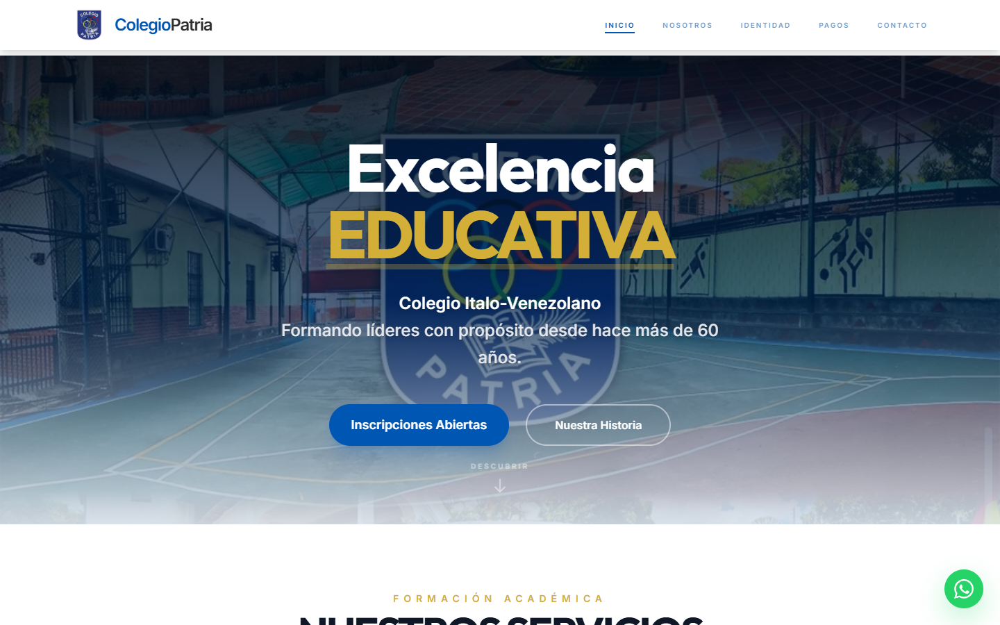

# Colegio Patria — Sitio institucional

**Plataforma web oficial de la U.E. Colegio Patria**, institución ítalo-venezolana con más de 60 años de trayectoria en Los Chorros, Caracas.
  

---

  

---

## Funcionalidades

**🎓 Oferta académica por nivel**
Rutas dinámicas (`/academia/:nivel`) para Preescolar, Primaria, Media General y Diversificado. Cada nivel muestra su descripción, materias, uniforme, requisitos de inscripción y listas de útiles descargables en PDF, todo generado desde una sola fuente de datos.

**💳 Registro de pagos vía WhatsApp**
Las cuentas bancarias del colegio se copian con un clic. El representante llena un formulario (alumno, cédula, banco, referencia) y el sistema arma un mensaje estructurado que abre directamente el chat de administración. Así el colegio recibe los pagos ordenados sin necesitar backend.

**🏛️ Identidad institucional**
Una sección interactiva inspirada en los aros olímpicos del escudo: cada aro despliega un pilar del colegio (Misión, Visión, Símbolos, Historia y Valores). También incluye un portal de himnos (Nacional, Italia, Estado Miranda, del Colegio y del Preescolar) con las letras desplegables.

**📍 Portal de atención**
Mapa de Google integrado, tarjetas de contacto, horario, preguntas frecuentes en acordeón y un botón flotante de WhatsApp en todo el sitio. El CTA de admisiones saluda según la hora del día ("Buenos días / tardes / noches").

**✨ Experiencia**
Contadores animados que arrancan al entrar en pantalla (`IntersectionObserver`), carruseles de fotos de la vida escolar con pausa al pasar el mouse, navegación con scroll al inicio en cada ruta y diseño pensado primero para móvil.

---

Desarrollado por **[Sneider Araque](https://github.com/Sneider22)**

